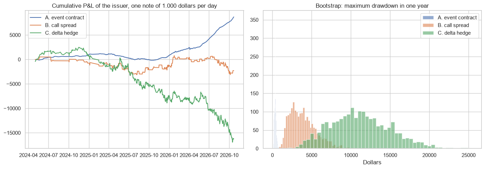
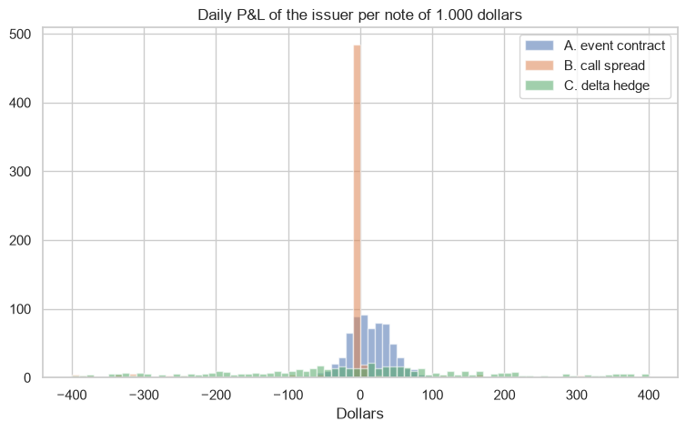

# Twin structured notes: hedging a digital coupon with event contracts or with options

This is the main empirical part of my Graduating Project at Rennes School of Business: *how do structured notes collateralized by prediction market contracts compare to notes hedged with traditional options in terms of basis risk, maximum drawdown and return on equity, in high and low volatility?*

**Twin notes:** the same promise to the investor, hedged in three ways, run every day from May 2024 to October 2026.
- **The coupon:** each day the investor buys a 1.000 dollar coupon that pays if Bitcoin closes above K at 5 pm New York the next day.
- **The price:** the issuer charges N(d2) with DVOL plus 4 cents per dollar.

The issuer hedges the coupon with:
- **A. Event contract:** Kalshi contracts of the same strike, bought at the ask. The payoff matches exactly, and the hedge is fully collateralized.
- **B. Options (static):** a call spread K - 0.5% / K + 0.5%, priced with DVOL plus 1 volatility point of bid-ask per leg. It settles on the Binance price.
- **C. Delta hedge (dynamic):** hourly rebalancing with perpetual futures, with 0.05% fees and 10% margin.

Volatility regimes come from a two-state Markov-switching model on daily Bitcoin returns. The drawdown distribution comes from a stationary bootstrap of 2.000 one-year paths.

**Data:**
- Kalshi KXBTCD quotes and settlements.
- Deribit DVOL.
- Binance BTCUSDT, hourly.

## Results
| Per note of 1.000 USD | A. Event contract | B. Call spread | C. Delta hedge |
|---|---|---|---|
| Mean P&L | +13.1 | -3.4 | -24.5 |
| Standard deviation | 32.8 | 154.4 | 268.4 |
| Expected shortfall 99% | 118 | 496 | 764 |
| Realised maximum drawdown | 1.355 | 3.900 | 19.403 |
| Bootstrap 1-year drawdown, median / 99% | 350 / 710 | 3.648 / 8.729 | 10.963 / 20.625 |
| Return on capital per note, collateral / with risk buffer | 2.5% / 0.8% | -0.6% / -0.1% | -0.6% / -0.2% |

- **Basis risk:**
  - The event contract has no payoff basis, only a price basis, and the price basis is small at the money (about 2 dollars against the options fair value).
  - The call spread keeps a payoff basis of 155 dollars per note: the days when Bitcoin closes between its strikes, plus the index difference.
  - The delta hedge cannot follow the gamma of a digital near expiry (268 dollars of payoff basis).
- **Drawdown:** the event contract hedge has a drawdown about 10 times smaller than the options hedges.
- **Cost:** the main cost is the bid-ask.
  - Each hedge costs per note: about 25 dollars at the Kalshi ask, 41 dollars for the options spread, and 50 dollars of fees for the delta hedge.
  - The event contract breaks even with a margin of about 2.7 cents per dollar.
  - Its profit grows in 2026, when the average Kalshi spread fell from 5.8 to 2.9 cents.
- **Regimes:**
  - In high volatility the event contract hedge stays stable.
  - The call spread works better than in calm days, because big moves rarely finish between its strikes.
  - The delta hedge has its worst tail in high volatility.
- **Limits:**
  - The options are priced with DVOL and an assumed bid-ask, not with real quotes.
  - The notes are one day long.
  - Depth is measured in the liquidity project.




## How to run
```
pip install -r requirements.txt
python collect_kalshi_btc.py      # already saved in data/kalshi_btc
jupyter notebook twin_notes.ipynb
```

---
Alejandro Lezcano Osorio | Rennes School of Business (MSc in Financial Data Intelligence) and Universidad EIA
